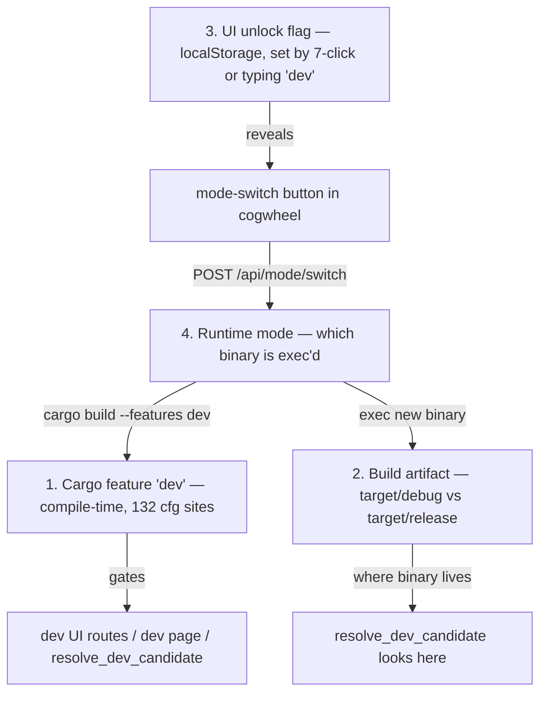
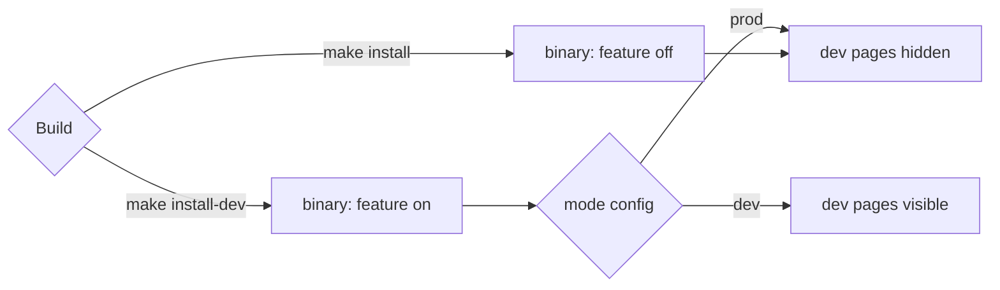
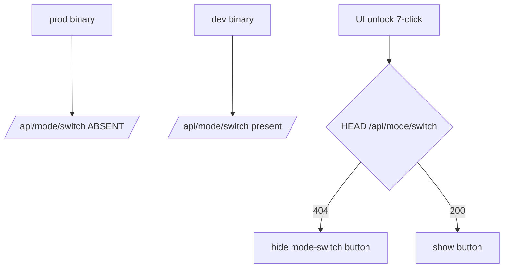

# TRAY-6 5. Dev/prod — the four overlapping notions

- **Status:** Accepted
- **Issue:** #6
- **Date:** 2026-05-03

## Problem

| ID | State | Smell |
|----|-------|-------|
| TRAY-6.1 | 1 | compile-time feature |
| TRAY-6.2 | 2 | build profile |
| TRAY-6.3 | 3 | UI unlock |
| TRAY-6.4 | 4 | runtime mode |

## Proposals

### Proposal A — Collapse to two axes: capability + runtime mode `[medium]`

Drop the cycle. Two axes, orthogonal:

The localStorage unlock and the mode-switch endpoint go away. Mode is a config file. make install-dev sets it; tray menu can flip it. No cycle.

| Pros | Cons |
|------|------|
| two orthogonal axes. No cycle. No localStorage gating a rebuild. End-user prod binary literally cannot show dev pages (capability not compiled). | removes the "magic 7-click recompile to dev" flow. Devs must run make install-dev manually. Loses a cute trick. |

Implementation notes:

- Capability is compile-time. A prod-feature binary returns `false` from `/api/dev/enabled` regardless of `mode.json`. Its `is_production_mode()` also ignores `mode.json` and always returns `true`, so dev-only settings never show in production.
- Runtime mode is file-backed and matters only in a dev-feature binary, where a missing `mode.json` means dev.
- Login autostart belongs to the production install whenever one exists. A dev-feature binary points it at a worktree build only on a machine with no production install, so a dev session that dies without cleanup cannot change what boots at login. The production install is the per-user install that `qol install` writes, at the production install path with its install marker. System-wide installs (the Debian package in `/usr/bin`, an app bundle in `/Applications` on macOS) are not detected, so on those machines a dev session can still point login at its build.
- `/api/dev/enabled` remains the unguarded capability probe. In a dev-feature binary, every other `/api/dev/*` route returns 404 while runtime mode is prod.
- The tray menu toggle writes `mode.json`, but the tray label/check state refreshes only after restart.
- An already-open UI sees mode changes after refresh/reopen, not live.
- `qol dev` starts the tray with `--write-mode=dev`, and `qol install --dev` writes `mode = dev` through `write_mode_config`. The tray-menu toggle flips the value. A dev-feature binary with no `mode.json` boots in dev mode.
- `qol install --dev` installs only the development tray. It leaves the shared plugins folder and the workspace build record (`host-workspace-build`) to production installs, because production refuses installed plugins built with development intent and compares that record with its own commit to decide whether it runs a workspace build.

**Closes:** TRAY-6.1, TRAY-6.3, TRAY-6.4

---

### Proposal B — Keep the cycle, fence the gates `[cheap]`

Keep all 4 notions but make each one's gate explicit and matched. switch_to_dev becomes cfg(feature = "dev")-only (so prod binaries don't even register the route). UI unlock check first probes whether the endpoint exists; if not, hides the button.

Recommended: A. Collapses 4→2, kills the cycle, costs one config file.

| Pros | Cons |
|------|------|
| tiny diff. Fixes the immediate "prod button does nothing" smell. | cycle remains. Future maintainer still has to reason about 4 notions. Doesn't solve the architectural confusion you started this session for. |

**Closes:** TRAY-6.4
